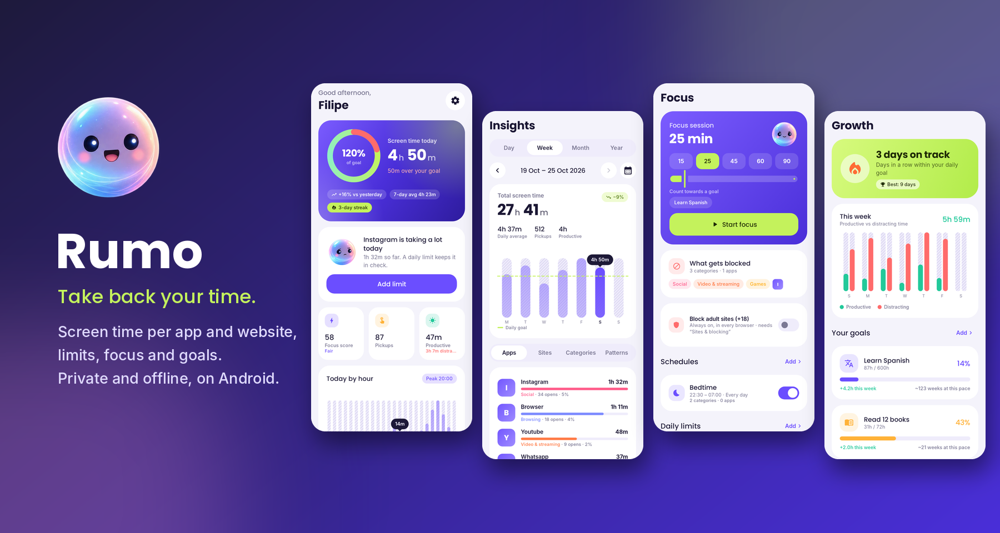
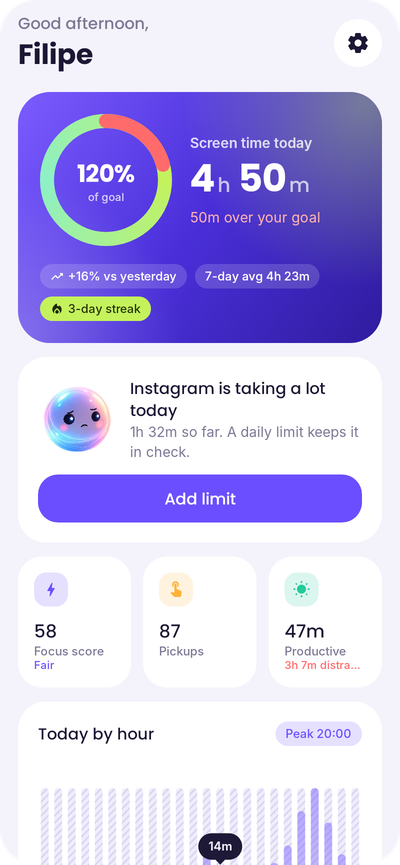
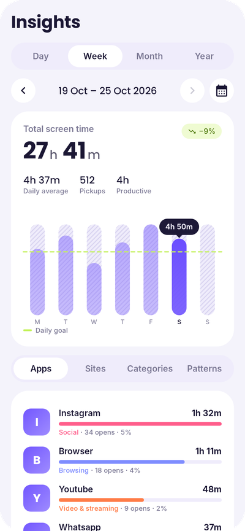
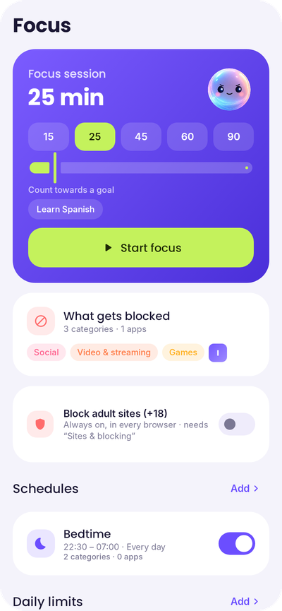
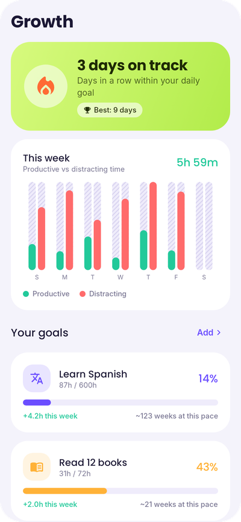
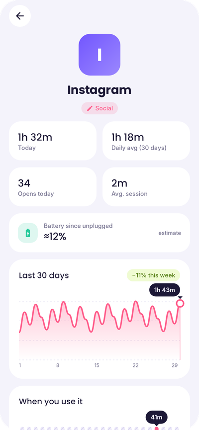
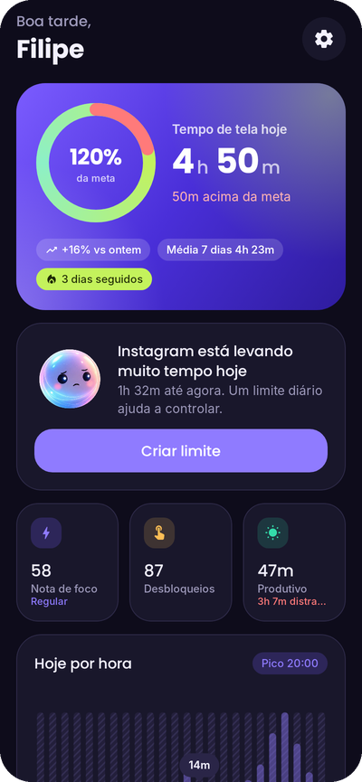
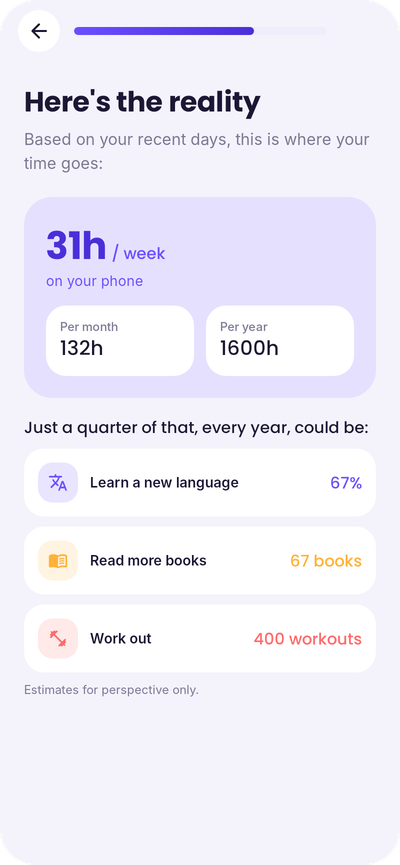

<div align="center">


# Rumo

**Retome o rumo do seu tempo.**

Um app moderno de bem-estar digital para Android: tempo de tela por app **e por site**, limites que bloqueiam de verdade, sessões de foco, metas e um mascote simpático — 100% privado e offline.

[English](README.md) · [Português](README.pt-BR.md)

<a href="https://github.com/filipembcruz/rumo/releases/latest/download/rumo.apk">
  
</a>

<sub>Android 8.0+ · Gratuito e de código aberto · MIT</sub>

<br/><br/>



</div>

---

## Por que o Rumo

O Bem-estar digital do Android diz que você passou 3 horas no *Brave* — mas não **no quê**. O Rumo mostra os sites dentro do navegador, agrupa tudo por categoria, compara períodos e transforma o tempo perdido em algo concreto: *"este ano, isso poderia ter sido 1,7 idioma novo"*. E ajuda a mudar isso com limites, sessões de foco, horários programados e uma pausa consciente antes de abrir apps que distraem.

## Telas

| Início | Estatísticas | Foco | Evolução |
|:---:|:---:|:---:|:---:|
|  |  |  |  |

| Detalhes do app | Modo escuro | Onboarding | Tela de bloqueio |
|:---:|:---:|:---:|:---:|
|  |  |  |  |

<div align="center">
<br/>
<sub><b>Conheça o Rumi</b> — ele flutua, respira, pisca e muda de humor conforme o seu dia. Toque nele para comemorar.</sub>
</div>

## Funcionalidades

### 📊 Saiba para onde vai seu tempo
- **Tempo de tela por app**, com aberturas, sessão média, primeiro uso do dia e desbloqueios.
- **Tempo por site**, com o ícone de cada site, no Brave, Chrome, Firefox, Edge, Samsung Internet, Opera, DuckDuckGo e outros.
- **Categorias** para apps e sites (redes sociais, vídeo, jogos, aprendizado, produtividade…) — altere com um toque.
- **Estatísticas** por dia, semana, mês, ano ou período personalizado: barras animadas com a linha da meta, rosca por categoria, mapa de calor por hora e dia da semana, médias, dia mais longo e comparação com o período anterior.
- **Nota de foco** (0–100) a partir da meta, do equilíbrio e dos desbloqueios.
- **Estimativa de bateria** por app na carga atual.

### 🛡️ Tome o controle
- **Limites diários** por app, site ou categoria, iguais todo dia ou **diferentes por dia da semana** (ex.: mais tempo de sexta a domingo) — alerta em 80% e 100%, ou **bloqueio** quando o tempo acabar (com "mais 5 minutos" opcional).
- **Sessões de foco** com anel de contagem regressiva; apps e sites que distraem ficam bloqueados. **Modo rígido**: só encerra segurando.
- **Horários** como *Hora de dormir* ou *Trabalho* que bloqueiam categorias automaticamente.
- **Pausa consciente**: uma tela de respiração antes de abrir os apps escolhidos, mostrando quantas vezes você já os abriu hoje.
- **Bloqueio de sites adultos (+18)** em qualquer navegador.

### 🌱 Evolua
- **Metas em horas** (idioma, leitura, graduação, programação…) com progresso, ritmo semanal e previsão.
- **Registro de atividades** fora do celular e sessões de foco ligadas às metas.
- **Sequências**, recorde e **conquistas**.
- **"Esse tempo poderia ter virado…"** — tempo de tela não produtivo convertido em idiomas, livros, treinos ou noites de sono.

### ✨ E mais
- **Widget** (pequeno, médio e grande) com anel da meta, apps, sites e limites.
- **Notificações**: alertas de limite, lembretes gentis, resumo diário, relatório semanal e lembrete de dormir.
- **Onboarding** com suas metas, meta diária e um "choque de realidade" com seu uso real.
- **Inglês** e **Português (Brasil)**; tema claro, escuro ou do sistema.
- **Backups**: salve um arquivo JSON onde quiser (inclusive no Google Drive), compartilhe ou restaure.

## Instalação

1. No celular Android, baixe o **[rumo.apk](https://github.com/filipembcruz/rumo/releases/latest/download/rumo.apk)** e abra.
2. Permita a instalação pelo navegador ou gerenciador de arquivos quando pedir.
3. Abra o Rumo e siga o onboarding: permita o **Acesso ao uso** (obrigatório).

As atualizações instalam por cima e mantêm seus dados.

> **O Google Play Protect bloqueou a instalação?** Como o Rumo usa acessibilidade (para ler a barra de endereço e mostrar telas de bloqueio), o Play Protect pode barrar apps instalados fora da Play Store. Abra **Play Store → perfil → Play Protect → ⚙ → desative "Verificar apps com o Play Protect"**, instale e ative de novo.

### Ativando sites e bloqueio

O Android protege a acessibilidade de apps instalados fora da Play Store ("Configuração restrita"). O Rumo guia você em **Ajustes → Permissões → Sites e bloqueio**:

1. **Configurações → Acessibilidade → Apps instalados → Rumo** → ative (na primeira vez o Android recusa — é esperado).
2. **Configurações → Apps → Rumo → ⋮ (canto superior direito) → Permitir configurações restritas**.
3. Volte à **Acessibilidade** e ative o Rumo.

Prefere não usar? Use **"Sobrepor a outros apps"**: limites, foco, horários e pausa consciente continuam bloqueando apps (sem rastrear sites).

## Privacidade

- **Sem conta, sem servidores, sem anúncios, sem analytics.** Tudo fica só no seu celular.
- O serviço de acessibilidade lê **apenas qual app está na tela e a barra de endereço do navegador**. O Rumo nunca lê o que você digita, mensagens ou senhas.
- Uma notificação discreta aparece enquanto o rastreio de sites está ativo (dá para ocultar).
- **Ícones dos sites** são baixados direto dos sites que você visita (nunca por serviço de terceiros) e ficam salvos no celular. Desative em **Ajustes → Listas** e o Rumo não faz nenhuma conexão.
- Backups são arquivos sob seu controle.

| Permissão | Para quê |
|---|---|
| Acesso ao uso | Tempo por app, aberturas, desbloqueios (obrigatória) |
| Acessibilidade *(opcional)* | Sites nos navegadores, telas de bloqueio e pausa |
| Sobrepor a outros apps *(opcional)* | Bloqueio sem acessibilidade |
| Notificações *(opcional)* | Alertas, resumos e lembretes |

## Compilar

Requisitos: **JDK 17+**, **Android SDK 35**, **Gradle 8.11+**.

```bash
git clone https://github.com/filipembcruz/rumo.git
cd rumo
gradle assembleDebug
```

Cada push no `main` gera um APK assinado pelo **GitHub Actions** e publica em [Releases](https://github.com/filipembcruz/rumo/releases/latest). Detalhes técnicos, stack e estrutura do projeto estão no [README em inglês](README.md#build-from-source).

## Licença

[MIT](LICENSE) © Filipe Cruz
